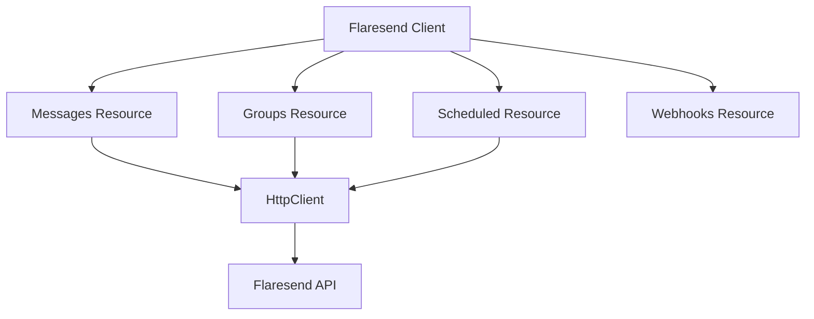

# Flaresend JavaScript SDK

Official JavaScript/TypeScript SDK for the [Flaresend](https://flaresend.com) WhatsApp Messaging API.

## Installation

```bash
npm install @flaresend/sdk
# or
yarn add @flaresend/sdk
# or
pnpm add @flaresend/sdk
```

## Features

- **Type-safe API**: Fully typed requests and responses.
- **Resource-based**: Intuitive organization (messages, groups, scheduled).
- **Minimal Dependencies**: Zero runtime dependencies (uses native `fetch`).
- **Dual Output**: Supports both ESM and CommonJS.

## Quick Start

```typescript
import { Flaresend } from "@flaresend/sdk";

const flaresend = new Flaresend("YOUR_API_KEY");

// Send a simple text message
const result = await flaresend.messages.send({
  recipients: ["254712345678"],
  type: "text",
  text: "Hello from Flaresend SDK!",
});

console.log(result.success ? "Message sent!" : "Failed to send");
```

## Usage

### Messaging

#### Send Image (via URL)

```typescript
await flaresend.messages.send({
  recipients: ["254712345678"],
  type: "image",
  url: "https://example.com/image.jpg",
  caption: "Beautiful sunset!",
});
```

#### Send File (using FormData - Browser/Node)

```typescript
// Assuming you have a File or Blob object
await flaresend.messages.sendFile({
  recipients: ["254712345678"],
  type: "document",
  file: myFileBlob,
  fileName: "report.pdf",
});
```

### Scheduled Messages

#### Schedule a message

```typescript
const scheduled = await flaresend.messages.schedule({
  recipients: ["254712345678"],
  type: "text",
  text: "Happy Birthday!",
  sendAt: "2025-11-14 13:48:00",
});
```

#### List scheduled messages

```typescript
const list = await flaresend.scheduled.list();
```

### Group Management

#### Create a group

```typescript
const group = await flaresend.groups.create({
  subject: "Dev Team",
  participants: ["254712345678", "254722334455"],
});
```

#### Send message to groups

```typescript
await flaresend.groups.sendMessage({
  groupJids: ["120363403582097887@g.us"],
  type: "text",
  text: "Meeting in 10 minutes!",
});
```

## Error Handling

The SDK provides custom error classes for better error handling:

```typescript
import { Flaresend, AuthenticationError, InstanceNotReadyError } from '@flaresend/sdk';

try {
  const flaresend = new Flaresend('INVALID_KEY');
  await flaresend.messages.send({...});
} catch (error) {
  if (error instanceof AuthenticationError) {
    console.error('Invalid API Key');
  } else if (error instanceof InstanceNotReadyError) {
    console.error('WhatsApp instance not connected');
  }
}
```

## Architecture


